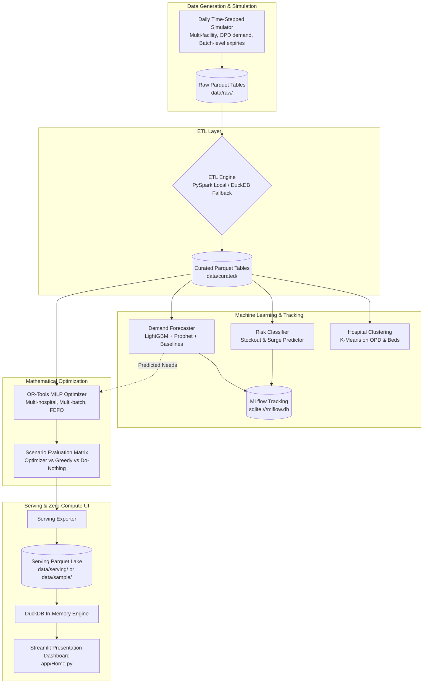

# Architecture Specification: Smart Medicine Redistribution System (v4)

## 1. Executive Summary

The **Smart Medicine Redistribution System for Government Hospitals** is an end-to-end data mining, predictive modeling, and mathematical optimization platform designed to solve two synchronized healthcare failures across public hospital networks: **preventable stockouts** (critical drug deficits) and **preventable wastage** (expiry of surplus medicines).

The platform enforces a strict separation between **heavy compute** (simulation, distributed ETL, model training, MILP optimization) and **lightweight presentation** (interactive Streamlit web dashboard querying precomputed Parquet serving tables via DuckDB).

---

## 2. Component Architecture

### 2.1 Daily Time-Stepped Simulator (`pipeline/simulator/`)
- Simulates a network of government healthcare facilities (District Hospitals, Sub-District Hospitals, Community Health Centers, Primary Health Centers).
- Generates reproducible, non-deterministic patient OPD traffic with seasonal monsoon surges, disease epidemic spikes (e.g. dengue), and supply disruptions.
- Tracks inventory at the individual **manufacturing batch level** (`batch_id`, `expiry_day`, `quantity`), modeling physical First-Expired-First-Out (FEFO) dispensing and aging.
- Operates under fixed random seeds for strict scientific reproducibility.

### 2.2 PySpark & DuckDB ETL Engine (`pipeline/etl/`)
- Ingests raw simulation logs, schema-validates transaction streams, and produces curated analytical datasets.
- **Dual-Engine Architecture:**
  - **PySpark (`ETL_BACKEND=spark`):** Utilized in Linux CI/CD pipelines and enterprise deployments.
  - **DuckDB (`ETL_BACKEND=duckdb`):** Lightweight zero-JVM local fallback for developer laptops (e.g., Windows environments without JDK/Hadoop binaries), guaranteeing identical curated output schemas.

### 2.3 Predictive Modeling Layer (`pipeline/models/`)
1. **Demand Forecasting:** Predicts rolling medicine consumption. Compares LightGBM and Prophet against a 7-day rolling average baseline. Produces point estimates and 95% confidence intervals.
2. **Stockout Risk Classification:** Evaluates inventory trajectories, predicting critical stockouts within 7 days using Random Forest/XGBoost.
3. **Hospital Clustering:** Clusters facilities into operational tiers using K-Means on patient footfall, distance matrices, and bed capacities.
4. **Experiment Tracking:** Logs model hyperparameters, WAPE/MAE metrics, and artifacts into local SQLite MLflow (`mlflow.db`).

### 2.4 Mathematical Optimization Formulation (`pipeline/optimizer/solver.py`)

The redistribution problem is modeled as a Mixed-Integer Linear Program (MILP) solved via Google OR-Tools (CBC/SCIP).

#### Sets & Indices:
- $i, j \in \mathcal{H}$: Dispatching ($i$) and receiving ($j$) hospitals ($i \ne j$).
- $m \in \mathcal{M}$: Medicines.
- $b \in \mathcal{B}_{im}$: Active batches of medicine $m$ held at hospital $i$.

#### Parameters:
- $c_{ij}$: Per-unit transportation cost from hospital $i$ to $j$ based on distance.
- $P_m$: Critical shortage penalty per unit of medicine $m$.
- $V_m$: Procurement unit value of medicine $m$ (INR).
- $\gamma$: Wastage penalty weight (default $\gamma = 5.0$).
- $\epsilon_{b}$: Soft FEFO tie-breaking factor ($\epsilon_b = \frac{0.01}{1 + \text{days\_to\_expiry}_b}$).
- $\text{avail}_{imb} \ge 0$: Units of batch $b$ eligible for transfer after reserving projected local demand and safety stock buffer:
  $$\text{avail}_{imb} = \max(0, \text{stock}_{imb} - \text{forecast\_demand}_{im} - \text{safety\_stock}_{im})$$
- $\text{need}_{j,m}$: Projected net shortage at hospital $j$ over the replenishment horizon:
  $$\text{need}_{j,m} = \max(0, \text{forecast\_demand}_{jm} + \text{safety\_stock}_{jm} - \text{stock}_{jm})$$
- $\text{at\_risk}_{imb}$: Units of batch $b$ at hospital $i$ that will expire within the planning horizon if not transferred or consumed.

#### Decision Variables:
- $x_{ijmb} \ge 0$: Transfer quantity of batch $b$, medicine $m$ from hospital $i$ to $j$.
- $s_{jm} \ge 0$: Unfulfilled shortage quantity of medicine $m$ at hospital $j$.
- $w_{imb} \ge 0$: Expected discarded wastage units of batch $b$ at hospital $i$.

#### Objective Function:
$$\min \sum_{i,j,m,b} c_{ij} x_{ijmb} + \sum_{j,m} P_m s_{jm} + \sum_{i,m,b} \gamma V_m w_{imb} - \sum_{i,j,m,b} \epsilon_b x_{ijmb}$$

#### Constraints:
1. **Source Availability:**
   $$\sum_{j} x_{ijmb} \le \text{avail}_{imb} \quad \forall i, m, b$$
2. **Shortage Accounting & Destination Need Cap (Anti-Dumping):**
   $$\sum_{i, b} x_{ijmb} + s_{jm} = \text{need}_{jm} \quad \forall j, m$$
   *(Since $s_{jm} \ge 0$, $\sum_{i,b} x_{ijmb} \le \text{need}_{jm}$, strictly preventing surplus dumping onto receiving hospitals).*
3. **Explicit Wastage Accounting:**
   $$w_{imb} \ge \text{at\_risk}_{imb} - \sum_{j} x_{ijmb} \quad \forall i, m, b$$
4. **Transit Lead-Time Feasibility:**
   $$x_{ijmb} = 0 \quad \text{if } \text{transit\_time}_{ij} > \text{days\_to\_stockout}_{jm}$$
5. **Shelf-Life Transit Viability:**
   $$x_{ijmb} = 0 \quad \text{if } \text{days\_to\_expiry}_{imb} \le \text{transit\_time}_{ij} + 2$$

---

## 3. Serving & Zero-Compute Presentation Layer

The Streamlit web application (`app/Home.py`) enforces the **Zero-Compute Rule**:
- **No Training:** Does not import `scikit-learn`, `lightgbm`, or `statsmodels`.
- **No Solving:** Does not import `ortools`.
- **No Simulation:** Does not simulate days on the fly.
- **Fast Columnar Queries:** Directly queries precomputed Parquet serving tables (`data/serving/` with fallback to `data/sample/`) using embedded in-memory DuckDB with 300-second TTL caching.
- Page render latency is strictly under 250 milliseconds.
